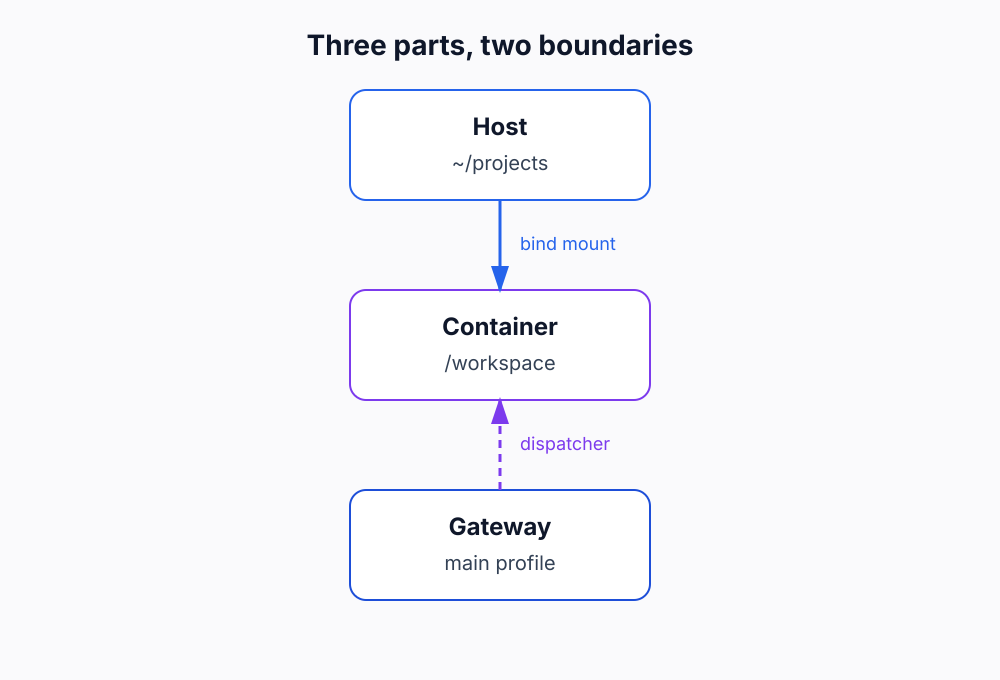
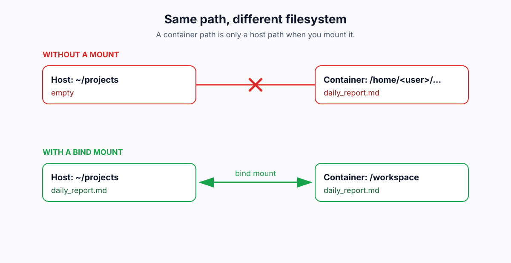

I run Hermes, a multi-profile AI agent, on a headless Linux box. I use it as a daily worker for long-running tasks, separate profiles, and a Discord interface. The model is not the part that gives me trouble. The failures are at the boundaries: the host, the Docker sandbox, the gateway, and the chat client.

## TL;DR

Docker isolates the agent's filesystem, and that isolation is the feature. The trap is that it also applies to the paths you type. My agent reported success while the file was in the container; a bind mount fixed it. The same boundary mistake appeared in the shell, `sudo`, the gateway, and Discord. This is the five-boundary check I wish I had before the first real run.

**What this post covers**

- [Docker's isolation boundary](#dockers-isolation-boundary) — why the sandbox is useful, and where the path boundary appears.
- [The run that reported success with a missing file](#the-run-that-reported-success-with-a-missing-file) — Done, but the artifact was in the container.
- [Trap 1: The container path is not the host path](#trap-1-the-container-path-is-not-the-host-path) — the bind-mount fix.
- [Trap 2: The host shell parses the prompt first](#trap-2-the-host-shell-parses-the-prompt-first) — quoting.
- [Trap 3: sudo uses a different PATH](#trap-3-sudo-uses-a-different-path) — resolving the binary.
- [Trap 4: A specialist profile starts a second gateway](#trap-4-a-specialist-profile-starts-a-second-gateway) — one gateway, many workers.
- [Trap 5: Discord drops messages without a mention](#trap-5-discord-drops-messages-without-a-mention) — mentions and threads.
- [What I learned about boundaries](#what-i-learned-about-boundaries) — the five checks and the first-hour rule.

## Docker's isolation boundary

Docker is useful because it gives a process its own filesystem, network, and process namespace while sharing the Linux kernel. An image pins the dependencies; a container is the running instance. On Linux, namespaces and cgroups make the container cheap: it is an isolated part of the host, not a second operating system.

Hermes uses Docker for that isolation. The agent runs arbitrary shell commands and Python scripts; the sandbox restricts the container's access to the host and lets each profile keep its dependencies. The containers stay alive with `sleep infinity`, so the next task reuses the installed dependencies.

**The container's `/workspace` or `/projects` is not the host's `~/projects` unless the host directory is explicitly mounted there.** The paths look the same. The files are not.



_Three parts, two boundaries._

## The run that reported success with a missing file

The first failure was the container path. The agent reported a successful run; the file was not on the host. The task was simple: write a report to a path under the project directory. The agent created the directory, wrote the file, and returned a clean stdout. The Kanban card moved to Done. Nothing in the transcript looked wrong.

Then I checked the host.

```text
$ ls ~/projects/tech_pulse
# (empty)
```

**The agent had done exactly what I asked. The problem was that the path was inside the container, not the host.** The container had its own root and writable layer. The write succeeded there. The host saw an empty directory. The exit code was zero; the artifact was in the wrong filesystem.

**That is the worst kind of agent failure: a successful-looking run with a missing result.**

## Trap 1: The container path is not the host path

**Issue:** The agent writes to an absolute path inside the container. The host sees an empty directory.

**Solution:** Bind-mount one host project directory into every container at a fixed path, and use that container path in the prompt.

The failure is easy to miss because the container path looks like a host path. A container starts from an image and adds a thin writable layer. When the agent runs `mkdir -p /home/<user>/projects/tech_pulse`, it creates a directory in that layer. The command is absolute, the path is valid, and the write is real. But the host's `/home/<user>/projects/tech_pulse` is a different directory in a different filesystem.

You can _rescue_ the files with `docker cp`:

```bash
docker cp <container-id>:/home/<user>/projects/tech_pulse ./tech_pulse
```

**That works once. It is not a fix.** The next run creates a new container, and the same thing happens. A rescue command is not a boundary.

**The fix is a bind mount: one host directory, mapped to a fixed path inside every container that needs it.**

```yaml
# Conceptual. The exact key depends on the Hermes/Docker backend config.
docker:
  volumes:
    - ${HOME}/projects:/workspace
```

The host directory is persistent; the container is disposable. Anything written under `/workspace` is written to `~/projects` on the host. The host sees it because it is the same directory, not a copy.

The notes show two conventions: `~/projects/` mounted to `/projects/` in the server blueprint, and `/workspace` as the default host-visible workspace in the operations guide. The exact path depends on the backend. **A mount in one container is not a mount in the next.** “No matter which Docker it opens” is true only if the mount is part of every container's configuration. The check is one sentinel file in the mounted workspace, read back from the host. If the host cannot see it, stop. The boundary is wrong.



_Same path, different filesystem._

## Trap 2: The host shell parses the prompt first

**Issue:** The host shell interprets the prompt before Hermes receives it.

**Solution:** Use single quotes around the payload, or write the prompt to a file.

The second failure looked like the agent had lost its instructions. It had not. I typed what looked like a clean prompt, hit enter, and watched the agent ask about a file that was never in the instruction. The host shell had already interpreted the prompt before Hermes received it.

A prompt is a string passed through the shell before Hermes sees it. Double quotes let the shell interpret backticks, variables, and substitutions. A filename in backticks can become a command substitution, or an empty string, before the agent reads it.

```bash
# bad: the host shell sees the backticks first
hermes kanban create --triage "Build `tech_pulse.py` and run it"

# good: single quotes pass the payload through
hermes kanban create --triage 'Build tech_pulse.py and run it'
```

Single quotes pass the payload through without interpretation. For a long prompt, use one single-quoted string or a prompt file. **The agent did not lose the prompt. The host shell parsed it before the agent saw it.**

## Trap 3: sudo uses a different PATH

**Issue:** `sudo` starts a new environment with a different `PATH`.

**Solution:** Resolve the binary before `sudo` takes over: `sudo "$(which hermes)" ...` or use the absolute path.

The third failure was a PATH problem, not a missing installation. I ran `sudo hermes gateway install --system`, got `command not found`, and checked whether Hermes was installed. It was.

Hermes installs its binary in `~/.local/bin/hermes`. `sudo` uses the system's `secure_path`, not your shell's `PATH`. The binary is there; `sudo` cannot find it.

```bash
# bad
sudo hermes gateway install --system
# sudo: hermes: command not found

# good
sudo "$(which hermes)" gateway install --system
```

**`sudo` is not just a different user. It is a different environment. Treat it as a boundary.**

## Trap 4: A specialist profile starts a second gateway

**Issue:** A specialist profile gets its own gateway and conflicts with the main one.

**Solution:** One gateway on the main profile; specialists are workers invoked by the dispatcher. Answer `n` to the standalone systemd service.

The fourth failure was a process conflict. I answered `y` to the setup wizard because it made the gateway sound like the responsible thing to install. The first gateway stopped accepting connections. The second gateway did not add a worker; it made the first worker unavailable.

The main profile runs the gateway and the dispatcher. The dispatcher reads the Kanban board and invokes specialist profiles. The specialists are workers; they do not need their own socket or background service. The setup wizard asks whether to install the gateway as a systemd service. For a specialist, answer `n`. **The gateway is a single service. The profiles are workers.**

## Trap 5: Discord drops messages without a mention

**Issue:** Discord drops messages without a mention, and the reply may land in a thread.

**Solution:** Mention the bot; check the thread; set `discord.free_response_channels` for log channels.

The fifth failure was a chat problem, not an agent problem. I sent a message and watched nothing happen. The logs showed the gateway was running. The reply was in a thread I had not opened.

Hermes runs with `DISCORD_IGNORE_NO_MENTION` on by default. A message without a mention is dropped before the agent sees it. The bot also auto-threads: the conversation can move into a thread, so the main channel looks silent while the agent works.

Mention the bot (`/sethome @Hermes AI Agent`), check the thread, and set `discord.free_response_channels` for a channel that should accept free responses. **The gateway was running. The reply was in a different thread.**

## What I learned about boundaries

I started with a working demo and an empty host folder. The fix was not a better prompt; it was a bind mount. The other four failures were the same mistake at different boundaries: I treated two systems as one.

Before the next deployment, I would run five checks. Write one sentinel file to the mounted workspace and read it from the host. Quote the prompt with single quotes so the host shell does not interpret it. Resolve the binary with `which` before `sudo`. Keep one gateway and treat specialists as workers. Mention the bot and check the thread. These are not model settings. They are boundary checks.

**The model is not the hard part. The boundary is.** If this saves one person from a successful-looking run with a missing file, the post has done its job.
